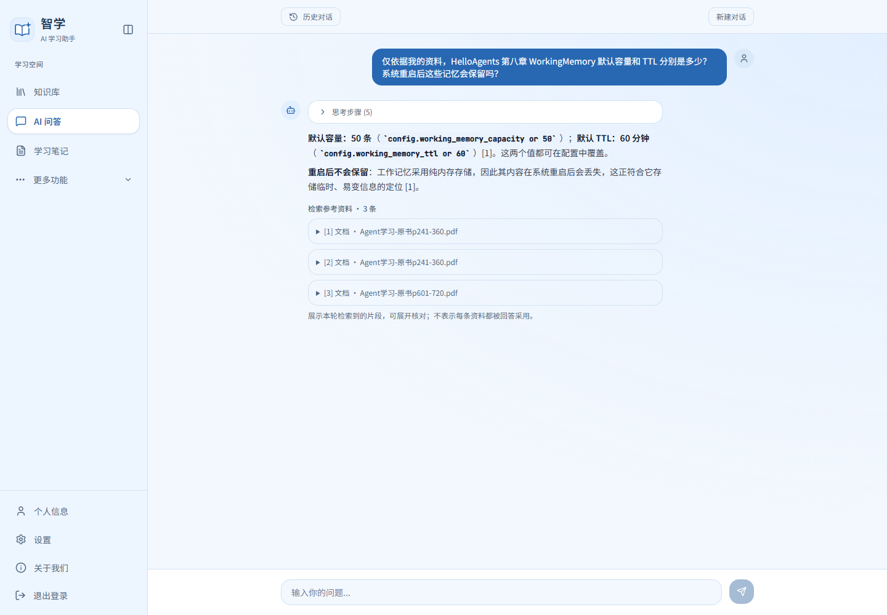
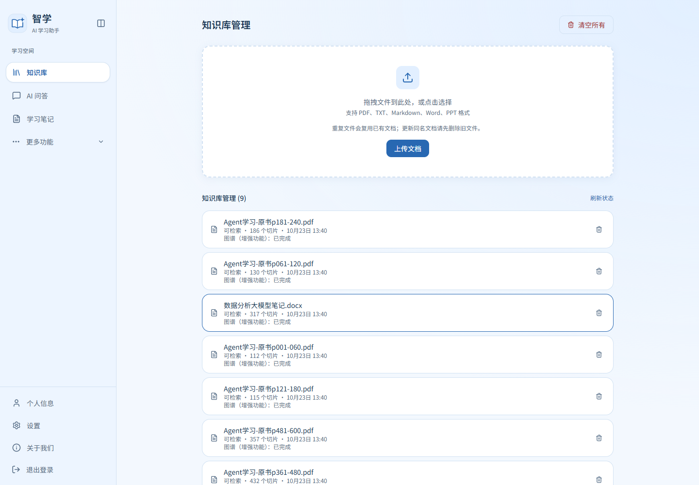
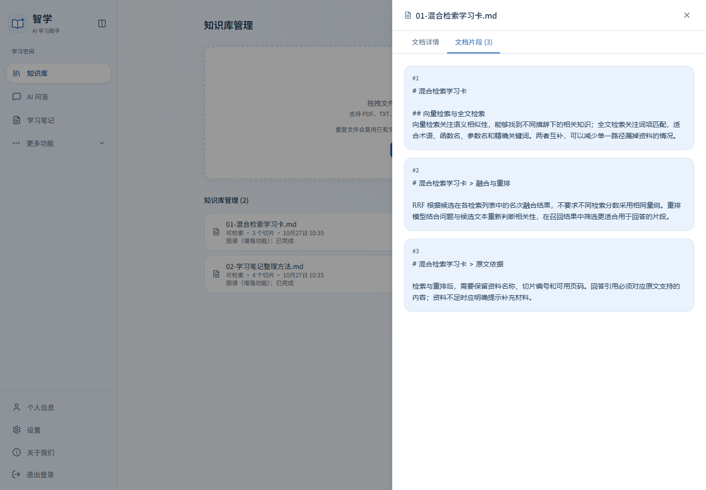
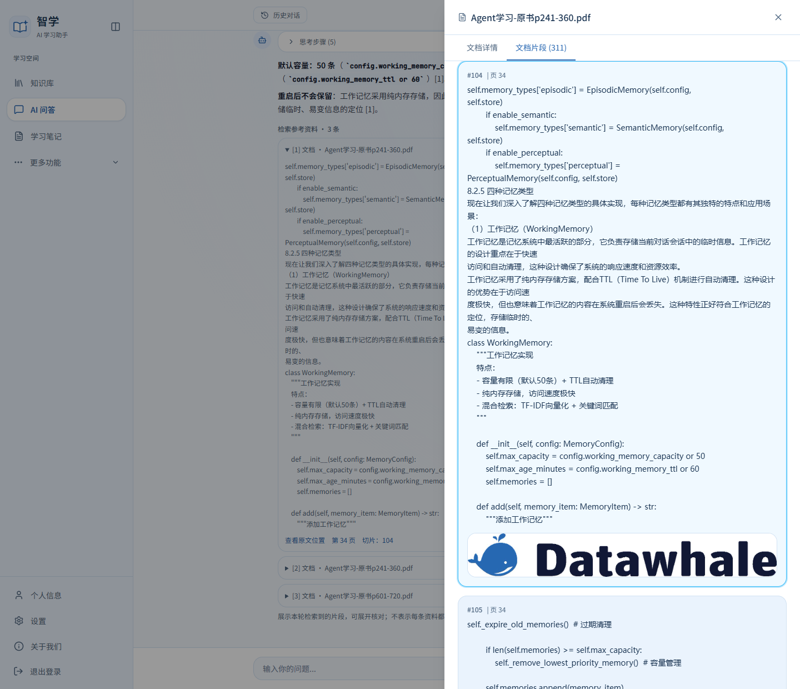
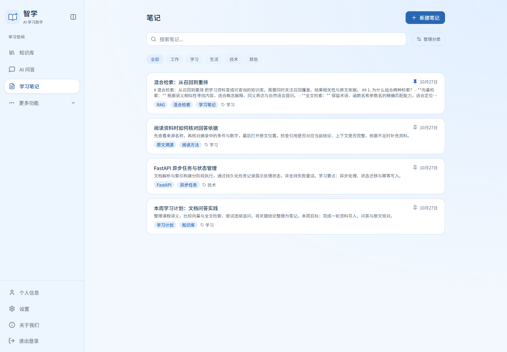
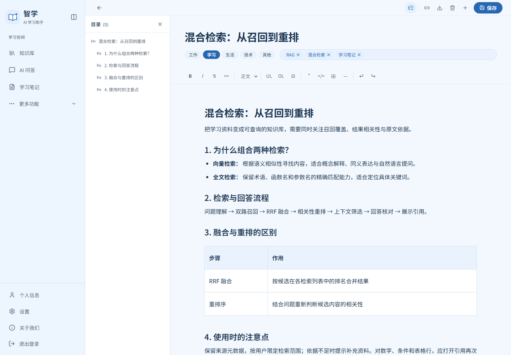
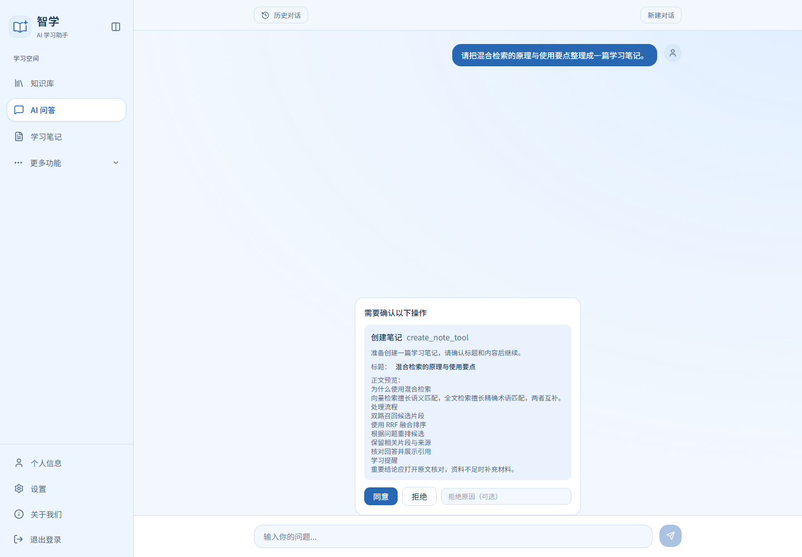
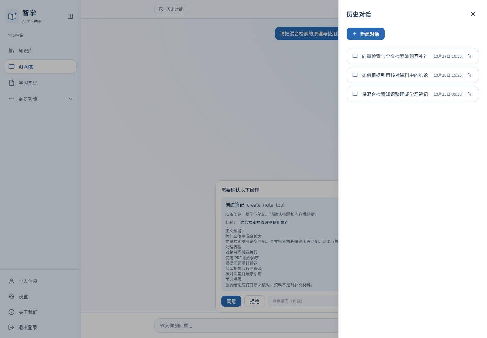
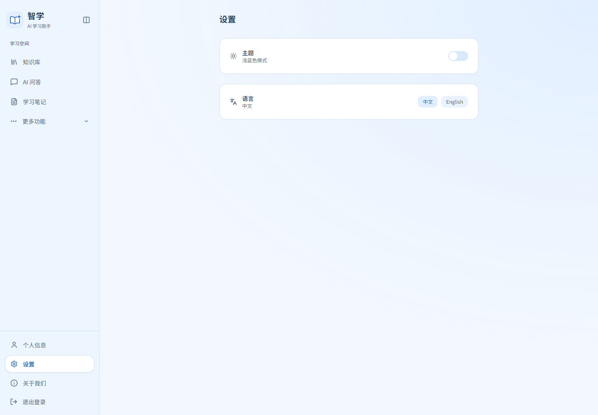
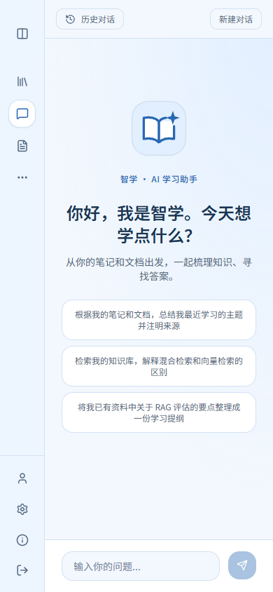

# 智学 · AI 学习助手

**把课程讲义、技术文档与个人笔记，整理成可以提问、核对和持续积累的学习知识库。**

智学是一个面向个人学习场景的 **RAG 知识库与 AI 学习助手**。上传 PDF、Word、Markdown 等资料后，可以围绕原文查询事实、比较概念、解释代码或综合多份资料；回答附带可展开的依据，支持查看原文片段与可用页码。需要保留的知识可以整理为笔记，并在后续问答中继续检索使用。

项目打通 **资料导入 → 结构切片与索引 → 混合检索与重排 → 依据判断与回答核对 → 引用溯源 → 笔记管理**，同时提供多轮追问、异步任务、历史恢复和用户资料隔离。界面采用浅蓝色风格，主要工作区为知识库、AI 问答和学习笔记。

[功能演示](#功能演示) · [核心实现](#核心实现) · [快速开始](#快速开始) · [架构说明](docs/ARCHITECTURE.md) · [完整使用指南](docs/FEATURES.md)

## 适合用来做什么

- **查找课程知识：** 从多份讲义中定位定义、参数、步骤和表格数据，减少逐个文件翻找。
- **理解与比较：** 根据现有资料解释代码、比较概念，检查结论分别来自哪些来源。
- **连续追问：** 先问一个知识点，再追问“它的限制是什么”“这个参数怎么用”，系统补全对象后重新检索。
- **整理学习笔记：** 将知识整理为带分类、标签和结构的笔记，通过 Agent 辅助查询与创建。
- **复核与回看：** 展开引用核对原文，重新打开历史对话，保留当时回答使用的来源。

## 功能演示

以下展示项目的真实前端页面与交互状态；新增界面截图使用自编示例数据，不涉及个人账号信息或私人教材内容。逐项操作方法见 [完整功能指南](docs/FEATURES.md)。

### 1. 知识库：上传、索引与资料管理

支持 PDF、DOCX、Markdown、TXT、PPTX。文件解析后登记后台索引任务，页面展示等待、处理、完成和失败状态，可查看切片数量、重试失败任务、删除资料及对应索引。

### 2. 文档详情：查看切片与原文位置

打开资料详情，查看正文、切片和可用位置。PDF 保留物理页码；章节和规则表格切片保留上下文，便于确认回答使用了文档的哪一部分。

### 3. AI 问答：检索资料并连续追问

支持事实查询、概念比较、代码解释和跨资料综合。系统先检索，再筛选上下文并判断依据是否充分；用户可以在同一会话继续追问，查看回答及引用来源。

### 4. 引用溯源：从结论返回原文

展开来源卡查看文档名称、摘录和可用页码，进一步打开对应资料位置。资料不足时给出明确提示；核对服务不可用时提示稍后重试。

### 5. 学习笔记：分类、标签、检索与编辑

使用分类、标签和置顶组织笔记，按关键词搜索；编辑器支持标题、列表、代码块、表格等内容，并提供 Markdown 导出与关联片段入口。

### 6. Agent 工具：创建前确认，审批后继续

Agent 可调用笔记检索、创建等工具。创建笔记前展示待执行内容，由用户批准或拒绝；执行检查点持久化保存，支持重新打开后恢复待审批状态并继续处理。

### 7. 历史会话：恢复正文与当时的引用

查看历史对话、创建新会话、删除不需要的记录。助手消息保存本轮来源快照，刷新或重新打开后仍能展开引用；时间按浏览器本地时区显示。

### 8. 界面与偏好：浅蓝色主题与移动端布局

提供浅色/深色主题和中英文切换；窄屏下可折叠侧栏，保留问答、知识库和笔记入口。

  
  

图谱浏览和每日回顾作为扩展功能位于“更多功能”，主流程聚焦资料、问答和笔记。完整操作与各模块说明见 [功能指南](docs/FEATURES.md)。

## 核心实现

| 环节 | 实现方式 |
| --- | --- |
| 文档解析与切片 | 多格式加载；章节标题继承；规则表格按完整行切分并重复表头；PDF 物理页码 |
| 可靠入库 | MySQL 持久化文档与任务；基础索引和图谱分阶段；内容哈希、认领令牌及有限重试 |
| 混合检索 | Neo4j 向量与全文双路召回，按用户及来源类型限定范围，使用 RRF 融合 |
| 云端重排 | 支持百炼 DashScope 与 compatible 协议；按 API 原始索引关联来源；异常时保留原检索顺序 |
| 上下文控制 | 候选召回数量、最终本地证据数量和字符预算分别配置，去重后构建带编号的上下文 |
| 回答核对 | 生成前判断证据充分性；生成后核对回答块、引用和原文摘录，资料不足时拒答 |
| 多轮问答 | 结合近期对话补全指代，重新检索本轮依据；历史回答不替代资料证据 |
| 来源与历史 | 助手消息持久化来源快照，历史恢复后继续展开引用及定位当前原文 |
| Agent 工具 | LangChain / LangGraph 工具调用、创建笔记审批和 MySQL checkpoint 恢复 |
| 用户与运行 | JWT 认证、服务层归属校验、SSE、取消与超时、Docker Compose、健康检查和 CI |

### 检索与回答流程

~~~mermaid
flowchart LR
    Q[问题与近期对话] --> C[指代补全与检索规划]
    C --> H[向量与全文检索]
    H --> R[RRF 融合与重排序]
    R --> B[去重及上下文预算]
    B --> A{证据充分}
    A -->|是| G[生成回答草稿]
    A -->|否| M[资料不足或核对不可用提示]
    G --> V[引用与原文核对]
    V --> O[正式回答与来源快照]
~~~

默认启用且配置完整的重排会将每个文本检索步骤的候选目标扩大至至少 20 条，重排后选择 3 条本地证据；融合结果继续受最多 8 条与 6000 字符预算约束。参数职责和调整方法见 [配置说明](docs/CONFIGURATION.md)。

受核对保护的资料回答先缓冲草稿，核对后再发送正式正文；SSE 提前推送处理阶段及来源，因此阶段事件和首段正式回答代表不同时间点。

## 系统架构

~~~mermaid
flowchart TB
    UI[React / TypeScript] --> NG[Nginx]
    NG --> API[FastAPI / JWT / SSE]
    API --> ING[解析与结构切片]
    ING --> TASK[持久化索引任务]
    TASK --> IDX[Embedding 与索引构建]
    IDX --> NEO[(Neo4j 切片 / 向量 / 全文 / 关系)]
    API --> RAG[检索与回答编排]
    NEO --> RAG
    RAG --> MODEL[模型服务与依据核对]
    MODEL --> OUT[回答 / 引用 / 来源快照]
    OUT --> UI
    API --> AGENT[LangChain / LangGraph 工具]
    AGENT --> SQL[(MySQL 业务 / 任务 / 历史 / checkpoint)]
    API --> SQL
    API --> REDIS[(Redis 缓存 / 黑名单 / 限流)]
~~~

更多存储职责、任务生命周期和失败处理见 [系统架构](docs/ARCHITECTURE.md)。

## 技术栈

| 层次 | 技术 | 用途 |
| --- | --- | --- |
| 前端 | React、TypeScript、Vite、Tailwind CSS、Zustand、Tiptap | 页面交互、状态与笔记编辑 |
| 后端 | Python、FastAPI、SQLAlchemy、Pydantic | API、业务访问、校验和鉴权 |
| 模型与 Agent | LangChain、LangGraph、OpenAI 兼容接口 | 模型适配、工具执行和状态恢复 |
| 检索存储 | Neo4j | 切片、向量和全文索引、关系扩展 |
| 业务与缓存 | MySQL、Redis | 业务数据、任务、历史、检查点、缓存及限流 |
| 重排服务 | DashScope / compatible | 云端候选相关性重排序 |
| 工程工具 | Docker Compose、Nginx、uv、pytest、Ruff、GitHub Actions | 环境、部署、回归和持续集成 |

## 快速开始

### 1. 准备环境

安装并启动 Docker Desktop，或 Docker Engine 与 Compose 插件。准备可用的对话模型和嵌入模型 API；首次构建包含文档解析依赖，需要预留下载时间和磁盘空间。

~~~bash
git clone https://github.com/CB-chubin/zhixue-rag.git
cd zhixue-rag
cp backend/.env.example backend/.env
~~~

Windows PowerShell：

~~~powershell
Copy-Item backend/.env.example backend/.env
~~~

### 2. 配置模型

在本机 backend/.env 中填写服务地址、模型名与密钥。对话、嵌入和重排可以独立配置：

~~~dotenv
OPENAI_BASE_URL=https://api.deepseek.com/v1
OPENAI_API_KEY=your-chat-api-key
OPENAI_MODEL_NAME=deepseek-chat

EMBED_BASE_URL=https://dashscope.aliyuncs.com/compatible-mode/v1
EMBED_API_KEY=your-embedding-api-key
EMBED_MODEL_NAME=text-embedding-v3

SECRET_KEY=replace-with-your-own-random-secret
~~~

百炼原生重排示例：

~~~dotenv
RERANKER_ENABLED=true
RERANKER_PROVIDER=dashscope
RERANKER_API_BASE_URL=https://dashscope.aliyuncs.com/api/v1
RERANKER_API_KEY=your-rerank-api-key
RERANKER_MODEL=your-enabled-rerank-model
~~~

重排未配置时可关闭。工作空间地址、规划模型、超时和完整参数见 [配置说明](docs/CONFIGURATION.md)。

### 3. 启动应用

~~~bash
docker compose up -d --build
docker compose ps
~~~

| 入口 | 地址 |
| --- | --- |
| Web 页面 | http://localhost:3000 |
| API 文档 | http://localhost:8000/docs |
| 健康检查 | http://localhost:8000/health |

本地演示初始化账号为 admin / admin1234，也可以注册自己的账号。对外提供服务前更改演示密码、签名密钥和基础设施默认凭据。

停止服务使用 docker compose down。保留数据卷可保留数据库内容，上传资料和本机运行数据分别挂载至 backend/media 和 backend/data。Windows 也可使用 start.bat、stop.bat。

### 4. 导入示例并体验

1. 在知识库上传 [Markdown 示例](demo/documents) 或 [PDF / Word 示例](demo/ingestion)。
2. 等待基础索引完成，进入 AI 问答。
3. 提问：“根据混合检索学习卡，为什么要组合向量检索与关键词检索？”
4. 展开引用，检查文档名称、原文和可用页码。
5. 继续追问：“那它用什么方式融合结果？”
6. 请助手将所学内容整理为笔记，确认待执行操作。
7. 刷新并打开历史会话，查看正文与引用恢复。

更多可复制的问题见 [使用示例](demo/README.md)。

## 目录结构

~~~text
backend/
  app/                 API、业务服务、文档处理、RAG 与 Agent
  tests/               自动化回归测试与精简样例
front/
  src/                 页面、组件、API 客户端与流式交互
demo/                  自编的可导入示例资料
docs/
  screenshots/         功能展示图片
  FEATURES.md          功能与操作指南
  ARCHITECTURE.md      系统架构
  CONFIGURATION.md     模型与运行配置
  DEVELOPMENT.md       本地开发
  TESTING.md           自动化检查说明
.github/workflows/     持续集成
docker-compose.yml     多服务运行编排
~~~

## 开发与质量检查

后端使用 Python 3.12、uv，前端使用 Node.js 22。

~~~bash
cd backend
uv sync --frozen --extra dev --no-group parsers
uv run --no-sync ruff check .
uv run --no-sync pytest -q
~~~

~~~bash
cd front
npm ci
npm run lint
npm run build
~~~

常规测试使用隔离数据与替身，外部服务专项测试未配置时会跳过。真实模型调用与答案语义需要结合实际环境核对，不能用静态检查或测试数量代替回答质量。

- [功能指南](docs/FEATURES.md)
- [系统架构](docs/ARCHITECTURE.md)
- [模型与运行配置](docs/CONFIGURATION.md)
- [本地开发](docs/DEVELOPMENT.md)
- [自动化检查](docs/TESTING.md)

## 适用范围

主要面向个人或小型学习资料库。复杂扫描件 OCR、多栏顺序、跨页表格等存在解析限制；模型核对仍可能漏检、误删或超时。后台任务恢复按单实例设计，多副本运行需要进一步引入任务租约与执行归属管理。来源快照保留当时依据，当前原文删除或更新后，打开结果可能变化。

## 许可证

使用 [MIT License](LICENSE)。第三方代码版权与许可信息见 [NOTICE](NOTICE)。
