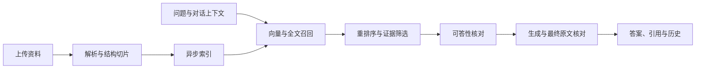

# 智学 · AI 学习助手

面向课程讲义、技术文档和个人笔记的 RAG 学习助手。上传资料后，可以基于原文提问、比较知识点、查看代码示例，并回到引用的文档位置核对答案。

前端采用浅蓝色界面，主流程是 **知识库 → AI 问答 → 学习笔记**。

## 项目界面

**资料问答**：基于已上传资料回答问题，展示回答依据和检索来源，支持继续追问。


**知识库管理**：上传学习资料，查看索引状态和文档切片数量。


**引用溯源**：展开回答引用，打开原文片段，核对页码、上下文与代码。


截图来自本机实际运行的界面。示例课程资料由使用者自行导入，完整教材与个人笔记不随仓库提供。

## 主要功能

- **文档入库**：支持 PDF、DOCX、Markdown、TXT、PPTX；保留标题路径、表格行及 PDF 物理页码，异步构建索引。
- **检索与重排**：Neo4j 向量与全文混合召回，可接百炼或 Cohere/Jina 兼容重排序；按用户和资料类型隔离检索。
- **资料问答**：支持多轮指代补全；先检查证据是否足够，再生成并核对回答。每项事实标注来源，资料不足时明确说明。
- **原文溯源**：查看引用片段、定位原文位置；回答与来源快照共同保存，刷新后可恢复历史。
- **学习笔记**：笔记编辑、分类、标签和关联资料。图谱与每日回顾保留在“更多功能”中。
- **评测工具**：固定题集、检索指标、回答要点、拒答、Top-K 对比和 SSE 耗时评测。

## 技术栈与流程

| 部分 | 技术 |
| --- | --- |
| 前端 | React、TypeScript、Vite、Tailwind CSS |
| 后端 | FastAPI、LangChain、LangGraph |
| 数据 | MySQL、Redis、Neo4j |
| 模型 | OpenAI 兼容回答/嵌入接口，可选云端重排序 |
| 运行 | Docker Compose、Nginx、JWT 用户认证 |



本地证据默认从 20 条候选中重排选取 3 条，融合上下文仍有字符和数量上限。这是当前题集对比后采用的配置，可以通过 `RAG_CONTEXT_K` 调整，详细条件及失败样例见 [Top-K 实验](docs/topk-20261023/README.md)。

## 快速启动

安装并启动 Docker Desktop，然后克隆项目并复制配置：

```bash
git clone https://github.com/CB-12345/zhixue-rag.git
cd zhixue-rag

cp backend/.env.example backend/.env
# 编辑 backend/.env，填写模型配置和自己的 SECRET_KEY

docker compose up -d --build
docker compose ps
```

Windows PowerShell 可以用 `Copy-Item backend/.env.example backend/.env` 复制配置，也可以直接运行 `start.bat`。

- 页面：http://localhost:3000
- API 文档：http://localhost:8000/docs
- 健康检查：http://localhost:8000/health
- 首次启动提供演示账号 `admin / admin1234`，对外使用前请修改密码。

至少配置回答与嵌入模型。不同供应商的接口可以组合使用，示例如下；密钥只填在本机 `.env` 中。

```dotenv
OPENAI_BASE_URL=https://api.deepseek.com/v1
OPENAI_API_KEY=your-chat-api-key
OPENAI_MODEL_NAME=your-chat-model

EMBED_BASE_URL=https://dashscope.aliyuncs.com/compatible-mode/v1
EMBED_API_KEY=your-embedding-api-key
EMBED_MODEL_NAME=text-embedding-v3

SECRET_KEY=replace-with-your-own-random-secret
```

重排序、规划模型和其他开关见 [backend/.env.example](backend/.env.example)。百炼重排序使用独立的重排序协议，接入说明见 [重排序与评测](docs/RERANK_AND_EVALUATION.md)。首次构建包含较大的文档解析依赖，需要预留下载时间和磁盘空间。

修改环境变量后重新创建后端，并刷新 Nginx 到后端的连接：

```bash
docker compose up -d --force-recreate backend
docker compose restart frontend
```

停止服务使用 `docker compose down` 或 `stop.bat`。保留 Docker 数据卷即可保留数据库；原始上传资料和运行数据由 `backend/media`、`backend/data` 挂载保存。

## 开发与测试

后端使用 Python 3.12 和 uv：

```bash
cd backend
uv sync --frozen --extra dev --no-group parsers
uv run --no-sync ruff check .
uv run --no-sync pytest -q
```

上述安装方式用于常规测试，跳过较大的解析依赖。需要实际处理多格式文档时安装默认 `parsers` 依赖组，或使用 Docker 镜像。依赖真实 Neo4j 的集成测试需要单独测试数据库；没有配置时会跳过，不能当作通过。

前端使用 Node.js 22：

```bash
cd front
npm ci
npm run lint
npm run build
npm run dev
```

需要后端自动重载时使用 [docker-compose.dev.yml](docker-compose.dev.yml)。持续集成检查后端 lint/测试及前端 lint/构建，支持 `main` 和 `master` 分支。

## 目录与演示

```text
backend/app/          后端业务与 RAG 链路
backend/tests/        自动测试
backend/evaluation/   固定评测输入
backend/scripts/      评测与维护工具
front/src/            前端页面与组件
demo/                 可公开的示例资料与演示问题
docs/                 设计说明和实验结果
scripts/              接口验收与性能工具
```

先用 [demo/ingestion](demo/ingestion/README.md) 中的自编 PDF 和 Word 示例体验导入；也可以上传自己的学习资料。完整教材、个人笔记、数据库、API 密钥和本机调试目录不随仓库上传。

- [文档与实验索引](docs/README.md)
- [固定演示步骤](demo/README.md)
- [架构与面试讲解](docs/SYSTEM_AND_INTERVIEW.md)
- [简历介绍与演示讲稿](docs/INTERNSHIP_READINESS.md)
- [最新收尾及仓库整理](docs/PUBLICATION_READINESS.md)
- [GitHub 上传说明](docs/GITHUB_PUBLISH.md)

## 评测边界

实验报告分别保留首次结果、修复回归和失败案例。小样本关键词通过、接口正常结束、核心答案完整和逐句引用准确是不同指标，不将它们合并成“线上准确率”。最终原文核对仍依赖模型，可能误删正确内容或漏检引用错误，也会增加等待时间。

## 来源与许可

项目起点为 [RMA-MUN/RAGNotebook](https://github.com/RMA-MUN/RAGNotebook)，当前版本围绕学习资料 RAG 的检索、原文溯源、回答核对、评测和界面进行了改进。保留上游作者信息与 [MIT License](LICENSE)。
