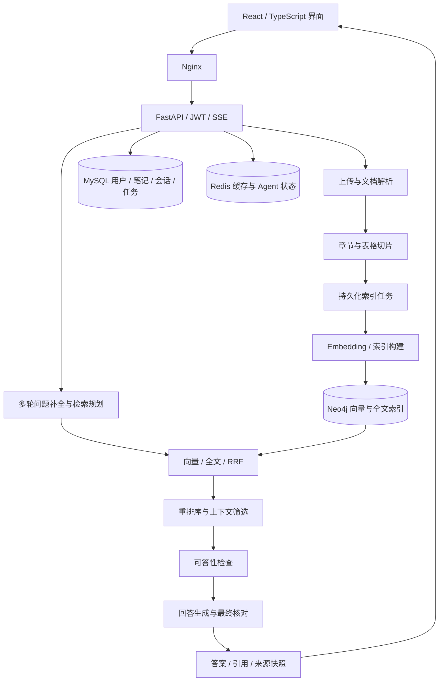

# 智学 · AI 学习助手

[](https://github.com/CB-12345/zhixue-rag/actions/workflows/ci.yml)
[](LICENSE)

智学是一个面向课程讲义、技术文档和个人笔记的 **RAG 学习助手**。它将分散的学习资料整理为可检索的知识库，通过自然语言问答帮助用户查找知识、比较概念、理解代码，并为回答提供可以展开核对的原文依据。

项目围绕 **资料导入 → 混合检索 → 重排序 → 依据核对 → 问答与溯源 → 笔记沉淀** 构建完整流程，同时提供多轮对话、异步索引、用户数据隔离和历史恢复能力。

## 项目界面

### 资料问答

围绕已上传的资料提问，查看回答、检索来源及引用片段，并在同一会话中继续追问。


### 知识库管理

集中管理学习资料，查看后台索引进度、处理状态和文档切片数量。


### 引用与原文溯源

从回答中的引用展开证据，查看上下文；对于带页码的 PDF，可以进一步定位到对应原文位置。


## 功能介绍

| 模块 | 主要能力 |
| --- | --- |
| 知识库管理 | 上传 PDF、DOCX、Markdown、TXT、PPTX；查看索引状态；重试失败任务；删除资料及对应索引 |
| 文档结构处理 | 按章节组织切片；保留标题路径；规则表格按完整行切分并重复表头；保留 PDF 物理页码 |
| 智能资料问答 | 事实查询、概念比较、代码解释、跨资料综合回答；证据不足时提示补充资料 |
| 混合检索与重排 | Neo4j 向量检索和全文检索；RRF 融合；云端重排序；去重与上下文预算控制 |
| 多轮对话 | 结合近期对话补全“它”“这个方法”等指代，再检索本轮需要的证据 |
| 回答核对 | 生成前判断资料是否支持作答；生成后检查回答块、来源编号和逐字摘录 |
| 引用溯源 | 展示文档名称、原文片段与可用页码；保存每轮回答对应的来源快照 |
| 学习笔记 | 编辑、分类和标记笔记；关联学习资料；通过 Agent 工具辅助整理笔记 |
| 会话管理 | 保存历史问答；刷新后恢复正文和引用；重新打开历史来源 |
| 用户与运行管理 | JWT 登录认证、按用户隔离资料、Docker Compose 启动、健康检查与 CI |

图谱关系浏览和每日回顾作为扩展功能保留在“更多功能”中，主使用流程聚焦知识库、问答和笔记。

## 核心实现

### 1. 兼顾语义匹配与精确关键词的检索

向量检索处理不同表述之间的语义关联，全文检索补充术语、方法名和编号等精确匹配。两路结果使用 RRF 融合，再由重排序模型按照当前问题重新排列候选。

检索在用户与来源类型的范围内执行。默认在启用且已配置重排时，每个文本检索步骤召回至少 20 条候选，重排后选取 3 条本地证据；最终上下文继续受字符预算和片段数量上限约束。这些参数可以独立配置。

### 2. 保留文档结构与可定位信息

文档解析后按标题和章节组织内容，降低切片失去上下文的问题。对于能够识别的规则表格，切片保留列名及完整数据行；长单元格根据预算拆分。PDF 使用物理页码标记位置，DOCX 等无法可靠获取物理页码的格式不推测页码。

### 3. 在回答前后核对依据

生成前，系统检查检索证据是否能回答问题，并校验核对模型给出的摘录是否存在于原文。生成后，再按回答块检查事实、引用编号和对应摘录；不受支持的内容会被过滤，核对不可用时返回明确提示。

资料问答的草稿会先缓冲，核对后再发送最终正文。前端通过 SSE 展示处理阶段并接收最终结果，避免将未经核对的草稿当成正式回答。

### 4. 将索引任务与交互请求分开

文档登记和后台任务持久化到 MySQL，基础索引与图谱构建分别维护状态。前端区分等待、运行、完成和失败，支持任务重试。后台通过内容哈希和认领令牌检查任务是否仍有效，减少旧任务覆盖新内容的问题。

### 5. 让历史回答仍然有据可查

助手消息与本轮来源快照一起保存，历史接口按轮次恢复正文和引用。来源卡可以继续打开文档片段或笔记；历史快照保留当时的依据，当前资料若已删除或更新，原文打开结果可能相应变化。

## 系统架构



更多模块职责、存储分工及失败处理见 [架构说明](docs/ARCHITECTURE.md)。

## 技术栈

| 层次 | 技术 | 用途 |
| --- | --- | --- |
| 前端 | React、TypeScript、Vite、Tailwind CSS | 页面、状态交互和浅蓝色界面 |
| 后端 | FastAPI、SQLAlchemy、Pydantic | API、数据访问、参数校验与鉴权 |
| RAG / Agent | LangChain、LangGraph | 检索编排、模型调用、工具执行与状态恢复 |
| 检索存储 | Neo4j | 文档切片、向量索引、全文索引和图谱关联 |
| 业务存储 | MySQL、Redis | 用户、笔记、会话、后台任务和运行状态 |
| 模型服务 | OpenAI 兼容接口、DashScope / compatible 重排接口 | 回答、嵌入和重排序 |
| 工程工具 | Docker Compose、Nginx、uv、pytest、Ruff、GitHub Actions | 环境、测试、构建和持续集成 |

## 快速开始

### 环境准备

安装并启动 Docker Desktop（或 Docker Engine 与 Compose 插件），准备可用的对话模型和嵌入模型 API。首次构建包含文档解析依赖，需要预留下载时间和磁盘空间。

```bash
git clone https://github.com/CB-12345/zhixue-rag.git
cd zhixue-rag
cp backend/.env.example backend/.env
```

Windows PowerShell 使用：

```powershell
Copy-Item backend/.env.example backend/.env
```

### 填写模型配置

在 `backend/.env` 中填写自己的服务地址、模型名及密钥。下面展示对话与嵌入使用不同服务的配置方式：

```dotenv
OPENAI_BASE_URL=https://api.deepseek.com/v1
OPENAI_API_KEY=your-chat-api-key
OPENAI_MODEL_NAME=deepseek-chat

EMBED_BASE_URL=https://dashscope.aliyuncs.com/compatible-mode/v1
EMBED_API_KEY=your-embedding-api-key
EMBED_MODEL_NAME=text-embedding-v3

SECRET_KEY=replace-with-your-own-random-secret
```

重排序是可选服务，支持百炼 DashScope 原生协议和 compatible 协议。独立规划模型、重排服务及超时参数见 [配置说明](docs/CONFIGURATION.md)。

### 启动服务

```bash
docker compose up -d --build
docker compose ps
```

| 入口 | 地址 |
| --- | --- |
| Web 页面 | http://localhost:3000 |
| API 文档 | http://localhost:8000/docs |
| 健康检查 | http://localhost:8000/health |

本地演示环境初始化账号为 `admin / admin1234`。可通过页面注册自己的账号；对外提供服务前更改演示密码和默认基础设施凭据。

停止服务使用 `docker compose down`。保留数据卷可以保留数据库内容；上传文件与本机运行数据分别挂载到 `backend/media` 和 `backend/data`。Windows 也可以使用 `start.bat`、`stop.bat`。

## 体验流程

1. 登录后进入知识库，上传 [demo/documents](demo/documents) 中的 Markdown 示例，或 [demo/ingestion](demo/ingestion) 中的 PDF、Word 示例。
2. 等待基础索引完成，在 AI 问答中提出事实查询或跨资料问题。
3. 展开回答引用，核对原文片段、上下文和可用页码。
4. 在同一会话继续追问，体验指代补全和重新检索。
5. 刷新页面或重开历史会话，检查回答与来源恢复。
6. 将需要保留的内容整理到学习笔记中。

可复制的问题和预期观察点见 [使用示例](demo/README.md)。仓库提供自编演示资料，用户自己的课程教材和笔记需另行导入。

## 目录结构

```text
backend/
  app/                 API、业务服务、文档处理、RAG 与 Agent
  tests/               单元、接口和集成测试
  evaluation/          自编的公开测试题集
  scripts/             评测与维护工具
front/
  src/                 页面、组件、API 客户端和交互逻辑
demo/                  可直接导入的示例资料
docs/                  架构、配置、开发和测试说明
scripts/               API 验收和 SSE 性能工具
.github/workflows/     持续集成流程
docker-compose.yml     本地运行编排
```

## 开发与测试

后端使用 Python 3.12 和 uv，前端使用 Node.js 22。

```bash
# 后端：常规测试跳过体积较大的 parsers 依赖组
cd backend
uv sync --frozen --extra dev --no-group parsers
uv run --no-sync ruff check .
uv run --no-sync pytest -q
```

```bash
# 前端
cd front
npm ci
npm run lint
npm run build
```

GitHub Actions 自动执行后端静态检查与测试、前端静态检查与生产构建。真实模型和外部数据库的专项验证独立运行，未配置相应服务时的跳过项不计为通过。

- [文档导航](docs/README.md)
- [系统架构](docs/ARCHITECTURE.md)
- [模型与运行配置](docs/CONFIGURATION.md)
- [本地开发](docs/DEVELOPMENT.md)
- [测试与验证工具](docs/TESTING.md)

## 当前边界

系统主要面向个人或小型学习资料库。复杂扫描件 OCR、无框表格、多栏阅读顺序和跨页表格仍有解析限制。回答核对依赖模型判断，可能出现漏检、误删和超时，引用存在本身不能证明答案完全正确。后台任务恢复按单实例设计，多副本运行需要进一步引入任务租约和执行归属管理。

## 许可证

使用 [MIT License](LICENSE)。第三方代码版权与许可信息见 [NOTICE](NOTICE)。
