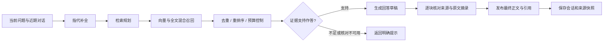

# 系统架构

## 模块职责

| 模块 | 代码入口 | 职责 |
| --- | --- | --- |
| HTTP 接口 | `backend/app/router/` | 登录、资料、问答、笔记、历史与健康检查 |
| 上传处理 | `backend/app/router/knowledge_service.py` | 文件校验、解析、文件级错误与任务登记 |
| 结构切片 | `backend/app/rag/structured_splitter.py` | 标题继承、表格行切分和长度预算 |
| 索引生命周期 | `backend/app/graph/services/graph_service.py` | 来源登记、索引更新、重试与删除 |
| 后台任务 | `backend/app/graph/services/graph_worker.py` | 基础索引及图谱任务的认领、执行和恢复 |
| 检索编排 | `backend/app/rag/agentic_rag/` | 指代补全、规划、召回、重排及可答性检查 |
| 回答核对 | `backend/app/rag/answer_verifier.py` | 回答块、引用、摘录与代码一致性检查 |
| 会话服务 | `backend/app/router/chat_service.py` | SSE、Agent 执行、回答和来源持久化 |
| 前端交互 | `front/src/` | 知识库、问答、原文查看、历史恢复和笔记 |

## 文档入库

1. 接口验证用户和上传文件，解析正文与可用位置元数据。
2. 对正文进行章节与表格切片，保留原文中的关键结构。
3. 在同一 MySQL 事务中登记来源及持久化构建任务。
4. 基础索引 worker 认领任务，生成向量并写入 Neo4j 的文档切片与索引。
5. 图谱 worker 在基础索引完成后处理实体关系；两阶段分别维护状态。
6. 前端查询任务状态，展示完成或失败，并提供重试入口。

同一用户重复上传相同文件复用既有登记。同名而内容不同的文件返回冲突，需要删除旧文件后重新上传。不同用户上传相同内容分别登记，检索与删除按用户范围执行。

任务使用内容哈希和认领令牌防止过期执行方回写。重启时恢复遗留任务的机制面向单实例，尚未提供跨实例租约。MySQL 与 Neo4j 之间没有分布式事务，跨存储删除失败可能需要重试。

## 检索与回答

检索计划可以面向文档、笔记或两者。Neo4j 在用户及来源类型范围内进行向量检索和全文检索，再使用 RRF 融合；小范围使用精确向量排序，大范围使用有上限的 ANN 候选扩展。图谱检索是可选的补充路径，独立超时后继续处理文本证据。

重排按供应商返回的原始文档索引关联来源。候选数量与最终上下文数量分别控制，避免扩大召回时直接扩大模型上下文。重排服务未配置、超时或返回异常时保留原召回顺序，后续证据检查仍执行。

可答性核对要求提供原文摘录，并由程序验证摘录是否连续存在于证据中。资料不足与核对服务暂不可用返回不同提示。最终回答核对还会检查来源编号、摘录与代码赋值等约束，并对部分可修复的引用问题执行有预算的重试。

这些约束降低无依据内容进入回答的机会，但语义是否受到原文支持仍依赖模型判断，不构成正确性保证。

## 数据分工

| 存储 | 内容 |
| --- | --- |
| MySQL | 用户、笔记、聊天记录、文档登记、任务状态与 Agent checkpoint |
| Neo4j | 文档与笔记切片、向量及全文索引、实体和关系 |
| Redis | 用户缓存、Token 黑名单与请求限流 |
| `backend/media` | 用户上传与解析产生的媒体文件 |
| `backend/data` | 本机运行数据、工具输出及临时资料 |

回答来源快照写入消息 metadata，历史接口按问答轮次返回来源。来源快照用于解释当时的回答；原文查看依赖当前来源仍然可用，系统尚未提供完整文档版本管理。

## 交互与失败处理

- SSE 传递处理阶段、最终正文、来源、完成及错误事件；Nginx 对流式接口关闭缓冲。
- 资料问答先缓冲草稿并核对，再发送最终正文，因此首段正文需要等待检索、生成和核对完成。
- 用户取消或连接断开时，相关异步分支会取消并回收；阶段超时使用各自的等待预算。
- 笔记创建等工具操作可以进入审批流程，由用户确认后恢复执行；Agent 执行状态与普通聊天历史分别管理。
- JWT 认证结合服务层的用户范围检查，限制资料和会话访问；部署仍需自行配置网络访问控制与凭据。
